<p align="center">
  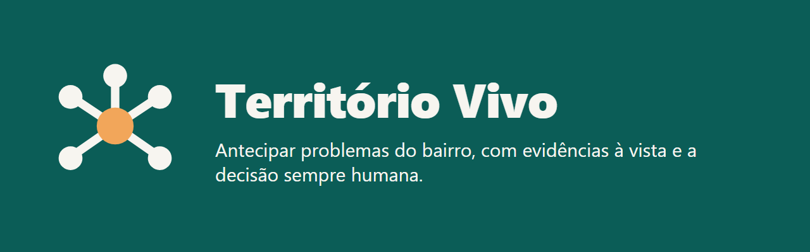
</p>

# Território Vivo

Painel de inteligência territorial que antecipa problemas dos bairros de São Paulo, mostrando evidências e limitações de cada alerta e deixando a decisão final com as pessoas.

## Problema e público

Vazamentos, calor extremo, ar poluído, alagamentos e filas em postos de saúde costumam ser percebidos só depois de atingir a população, e atingem mais quem já é vulnerável.

- **O que o app antecipa:** riscos ligados a água, energia, resíduos, clima, qualidade do ar e demanda por serviços públicos, com até 7 dias de antecedência.
- **Para quem:** gestores públicos, que analisam os alertas e registram decisões, e cidadãos, que acompanham o bairro e relatam ocorrências de forma anônima.
- **Impacto social esperado:** ganhar tempo de reação para as equipes locais, reduzir desperdício e tornar visíveis as diferenças entre bairros. O app mostra esses indicadores na tela **Benefício social**.

## Integrantes

| Nome completo | RM |
|---|---|
| [Nome Completo] | [RM] |

## Demonstração visual

| | | |
|---|---|---|
| 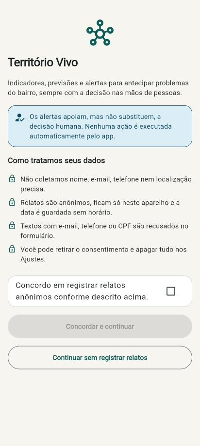<br>**Consentimento:** apresentação e aceite explícito | 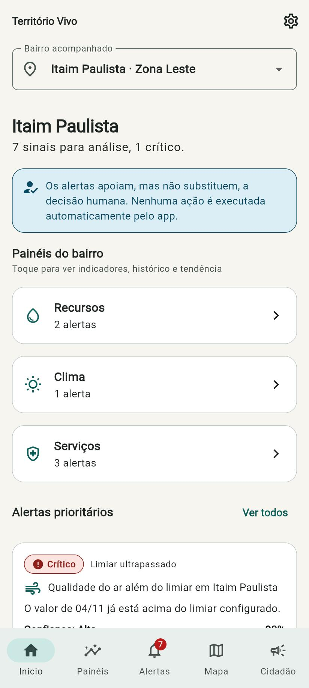<br>**Início:** resumo do bairro e alertas prioritários | 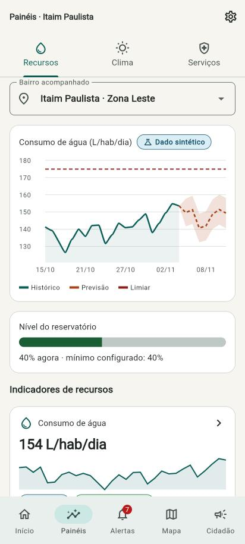<br>**Recursos:** água, energia, resíduos e reservatório |
| 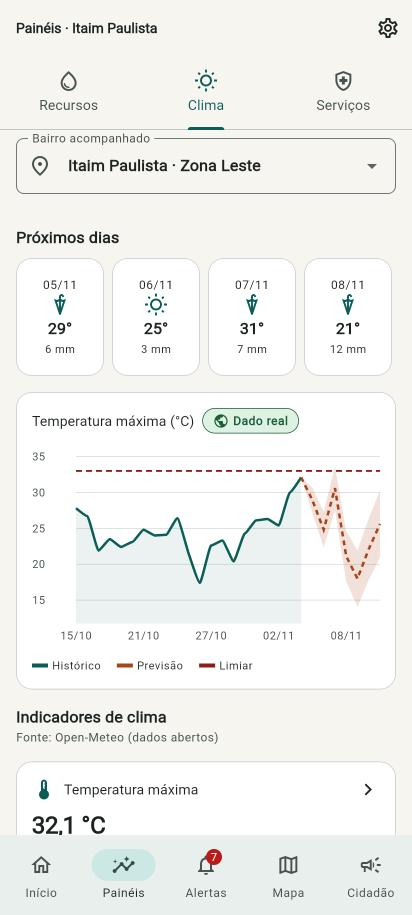<br>**Clima:** dados reais e previsão da semana | 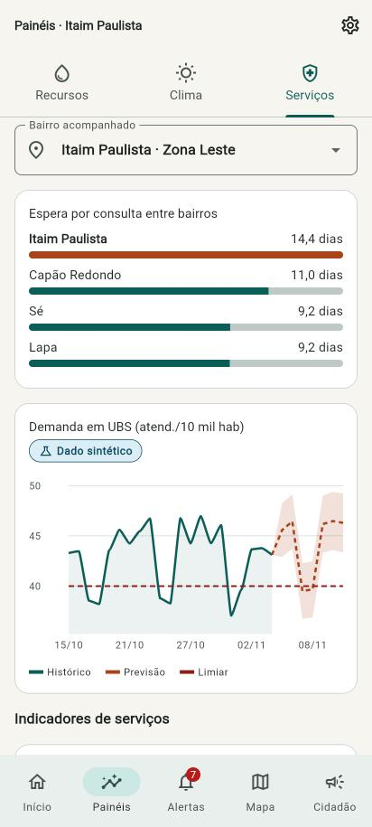<br>**Serviços:** demanda e comparação entre bairros | 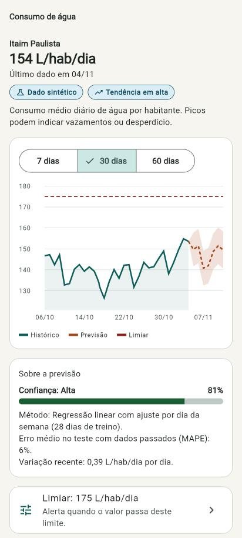<br>**Indicador:** histórico, previsão e limiar |
| 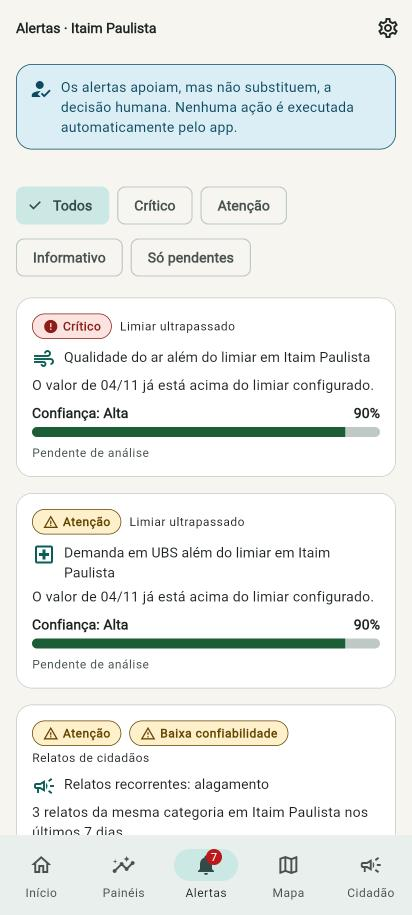<br>**Alertas:** lista com filtros | 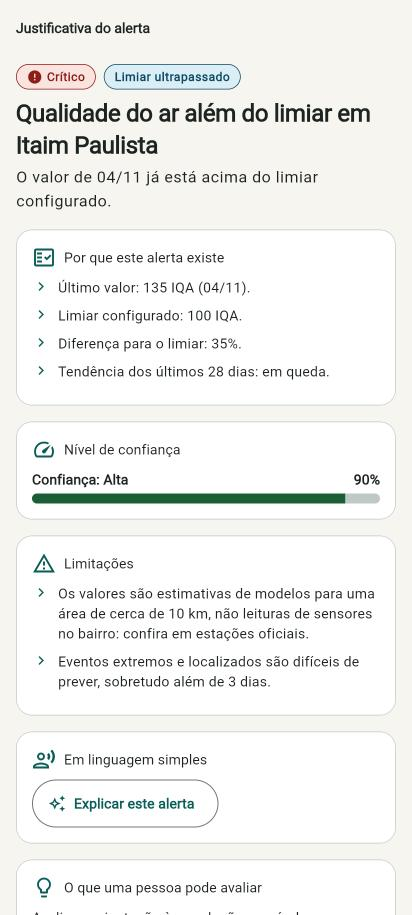<br>**Alerta:** evidência, confiança e limitações | 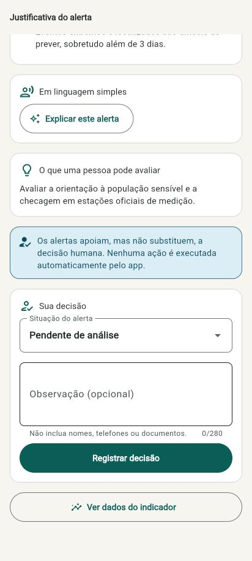<br>**Decisão humana:** registro da análise |
| 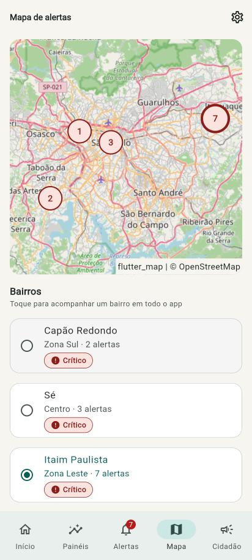<br>**Mapa:** alertas por bairro | 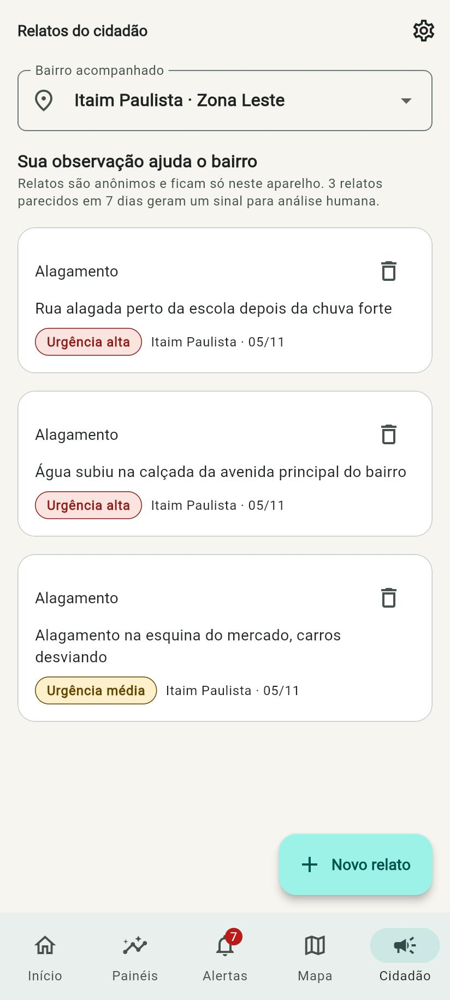<br>**Relatos:** ocorrências anônimas | 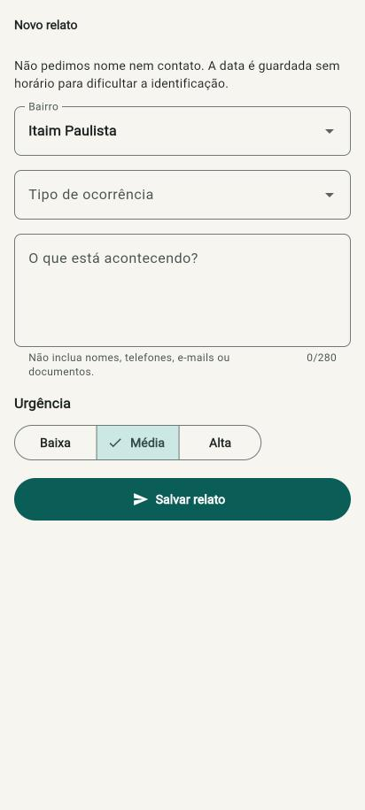<br>**Novo relato:** formulário com validação |
| 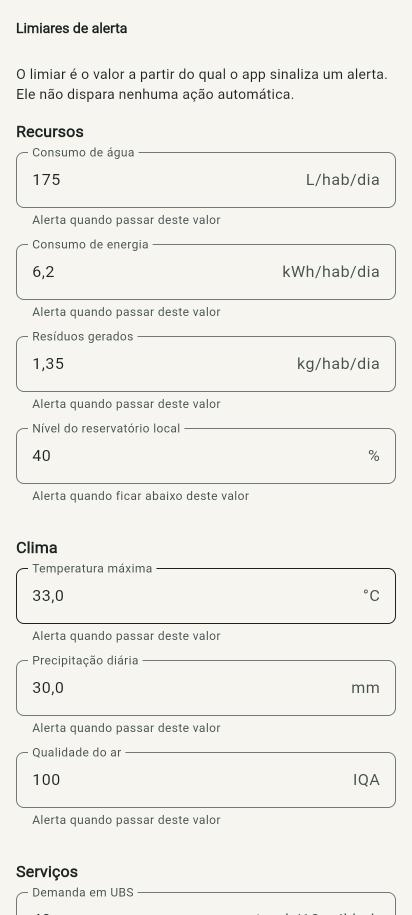<br>**Limiares:** configuração dos alertas | 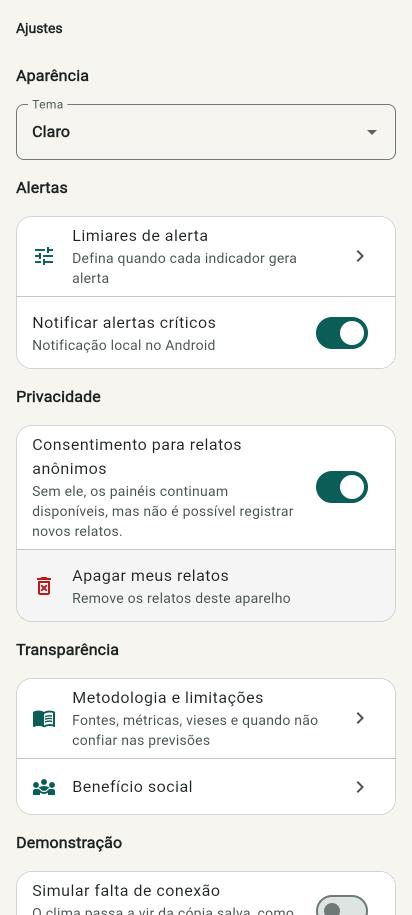<br>**Ajustes:** tema, privacidade e modo sem conexão | 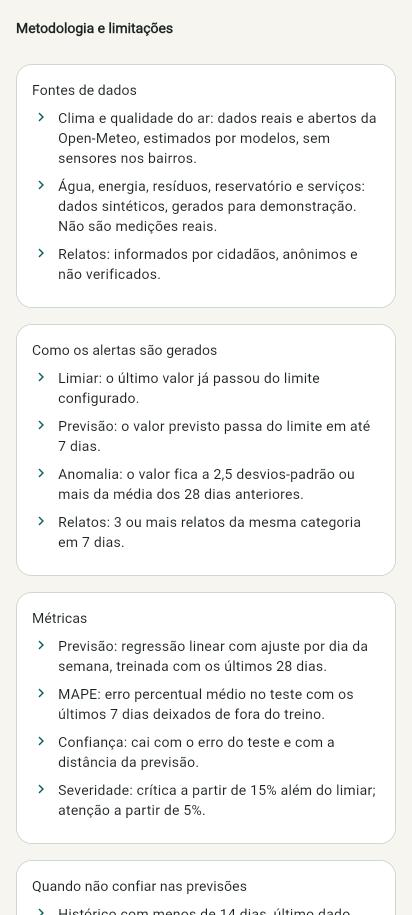<br>**Metodologia:** fontes, métricas e vieses |
| 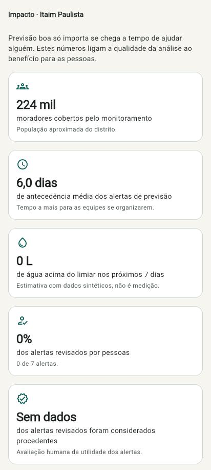<br>**Benefício social:** impacto das análises | 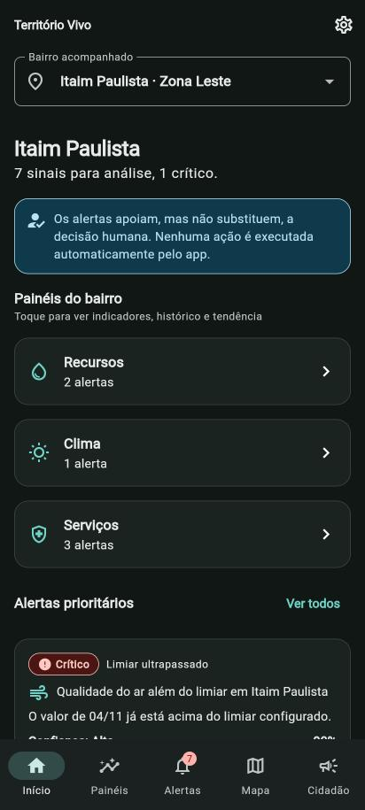<br>**Tema escuro** | 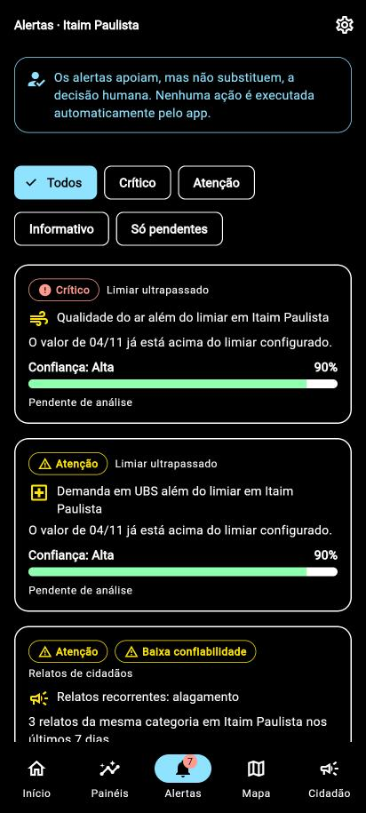<br>**Tema de alto contraste** |

## Funcionalidades

- [x] 13 telas com rotas nomeadas e parâmetros, incluindo a etapa de consentimento
- [x] Fluxo visão geral → indicador → alerta
- [x] 3 painéis distintos (recursos, clima e serviços), com gráficos, histórico e tendência
- [x] Previsão de 7 dias com faixa provável e erro medido
- [x] Alertas com evidência, nível de confiança, limitações e aviso de decisão humana
- [x] Registro da decisão humana em cada alerta
- [x] Relatos anônimos de cidadãos, com validação e bloqueio de dados pessoais
- [x] Formulário de limiares que recalcula os alertas na hora
- [x] Funcionamento offline, com cache do clima e aviso visível
- [x] Estados de carregamento, erro e lista vazia
- [x] Indicadores de benefício social
- [x] Mapa de alertas por bairro (OpenStreetMap)
- [x] Notificação local de alertas críticos (Android)
- [x] Explicação em linguagem simples, com IA generativa opcional
- [x] Tema claro, escuro e de alto contraste
- [x] Testes automatizados de lógica, validação, contraste e layout

## Dados e alertas

### Fontes

| Indicadores | Origem | Observação |
|---|---|---|
| Temperatura, chuva e qualidade do ar | **Reais**, da [Open-Meteo](https://open-meteo.com/) | Estimativas de modelos, sem sensores nos bairros |
| Água, energia, resíduos e reservatório | **Sintéticos** | Gerados no aparelho por um serviço que simula uma API |
| Demanda em UBS, zeladoria e espera por consulta | **Sintéticos** | Não representam a situação real dos bairros |
| Relatos | Informados pelo usuário | Anônimos, não verificados e guardados só no aparelho |

As populações dos bairros são aproximadas e usadas apenas em estimativas agregadas.

### Como os alertas são gerados

| Tipo | Regra |
|---|---|
| Limiar ultrapassado | O último valor passou do limiar configurado |
| Previsão | O valor previsto passa do limiar em até 7 dias |
| Anomalia | O último valor está a 2,5 desvios-padrão ou mais da média dos 28 dias anteriores |
| Relatos | 3 ou mais relatos da mesma categoria no bairro em 7 dias |

A **severidade** é crítica a partir de 15% além do limiar, de atenção a partir de 5% e informativa abaixo disso.

### Métricas

- **Modelo:** regressão linear com ajuste por dia da semana, treinada com os últimos 28 dias. Para clima, o app usa a previsão da Open-Meteo.
- **MAPE:** erro percentual médio em um teste que deixa os últimos 7 dias fora do treino.
- **Confiança:** calculada a partir do MAPE (ou de um valor fixo para a previsão externa) e reduzida conforme a previsão se afasta no tempo. Esse valor é uma heurística explicável, não uma probabilidade calibrada.
- **Benefício social:** moradores cobertos, antecedência média, água acima do limiar, taxa de revisão humana e alertas considerados procedentes. São estimativas de potencial, não resultados comprovados.

### Limitações e vieses

- Os dados sintéticos servem para demonstração e não devem embasar decisões reais.
- O modelo projeta padrões recentes e é simples de propósito, para rodar offline e ser explicável.
- Os dados climáticos cobrem áreas de cerca de 10 km e podem esconder diferenças dentro do bairro.
- Relatos digitais sub-representam quem tem menos acesso à internet. A ausência de relatos não significa ausência de problema.
- Limiares iguais para bairros diferentes podem não refletir as necessidades de cada lugar.

### Quando as previsões não são confiáveis

O app detecta estes casos, marca o alerta e impede que ele chegue ao nível crítico:

- histórico com menos de 14 dias;
- último dado com mais de 3 dias;
- MAPE acima de 25%.

O app **não** consegue detectar eventos sem precedente nos dados, como obras, rompimentos, greves ou mudanças bruscas de clima. Isso cabe às pessoas responsáveis.

### Decisão humana

O app não executa nenhuma ação a partir de um alerta. Ele sinaliza, justifica e registra o que a pessoa decidiu.

## Privacidade e inclusão

**Privacidade**

- Nenhum dado de identificação é pedido: nada de nome, contato, conta ou localização do aparelho.
- O formulário recusa textos com e-mail, telefone ou CPF.
- Relatos recebem um identificador aleatório, ficam só no aparelho e guardam a data sem horário.
- O consentimento é explícito e pode ser retirado nos Ajustes, onde também é possível apagar os relatos. Sem ele, os painéis continuam disponíveis.
- A IA generativa, quando ativada, recebe só dados agregados do alerta, nunca relatos.

**Acessibilidade**

- Temas claro, escuro e de alto contraste, com contraste de 4,5:1 verificado por teste nas cores de estado e de texto principais.
- Layout testado com fonte em 200% em tela de 360 px, além de teste visual em celular e tela larga.
- Descrições para leitores de tela em cartões, botões e gráficos, que recebem um resumo em texto.
- Estados informados por ícone e texto, nunca só por cor.
- Animações desligadas quando o sistema pede movimento reduzido.

## Tecnologias e decisões técnicas

| Escolha | Justificativa |
|---|---|
| **Flutter** | Requisito da disciplina; uma base de código para Android e web |
| **provider + ChangeNotifier** | Estado global simples e fácil de explicar, separado do estado local das telas (filtros, período do gráfico e campos) |
| **go_router** | Rotas nomeadas, parâmetros, navegação com abas e redirecionamento para o consentimento |
| **fl_chart** | Gráficos de linha e barras com faixa de previsão e linha de limiar |
| **http + Open-Meteo** | Dados reais e abertos, sem chave de API |
| **shared_preferences** | Persistência simples de cache, limiares, relatos e decisões, isolada em `LocalStore` para facilitar uma troca futura |
| **flutter_map + OpenStreetMap** | Mapa sem chave de API |
| **flutter_local_notifications** | Avisos locais, sem depender de servidor |
| **Claude API (opcional)** | Explicação em linguagem simples, com texto automático quando não há chave ou a chamada falha |
| **Regressão no próprio Dart** | Roda offline, sem servidor, e cada número pode ser explicado |

### Arquitetura

```text
lib/
├── core/       tema, tokens visuais e rotas
├── domain/     modelos, previsão, alertas, validação e impacto (sem Flutter)
├── data/       Open-Meteo, dados sintéticos, cache, notificações e explicações
├── state/      controladores globais compartilhados entre as telas
├── shared/     componentes reutilizáveis e gráficos
└── features/   uma pasta por área de tela
test/           testes de unidade e de widget
```

A dependência segue uma direção: `features → state → data → domain`. Como o `domain` não depende de Flutter, a lógica de alertas é testada de forma isolada.

## Como executar

**Pré-requisitos:** [Flutter](https://docs.flutter.dev/get-started/install) stable (testado na 3.47.9) e, para Android, o Android SDK.

1. Clone o repositório e entre na pasta:

   ```bash
   git clone https://github.com/SEU-USUARIO/SEU-REPOSITORIO.git
   cd SEU-REPOSITORIO
   ```

2. Instale as dependências:

   ```bash
   flutter pub get
   ```

3. Rode o app em um emulador, celular ou no Chrome:

   ```bash
   flutter run
   ```

4. Rode os testes:

   ```bash
   flutter test
   ```

### Variáveis de ambiente (opcional)

O app funciona sem nenhuma chave. Para ativar a explicação por IA generativa, copie `env.example.json` para `env.json`, informe sua chave e rode:

```bash
flutter run --dart-define-from-file=env.json
```

O arquivo `env.json` está no `.gitignore`. Use essa opção só em desenvolvimento: uma chave embutida em um APK pode ser extraída, então não a inclua em versões distribuídas. Em produção, a chamada deveria passar por um servidor.

### APK

```bash
flutter build apk --release
```

O APK instalável fica disponível na aba **Releases** do repositório.

> **Windows:** se o build falhar com erro de caminho não encontrado, coloque o projeto em uma pasta de caminho curto, como `C:\src\territorio_vivo`.

## Vídeo

[Assista à demonstração](COLE-AQUI-O-LINK-DO-VIDEO)

## Licença

Projeto acadêmico, FIAP, Global Solution 2026.2.
